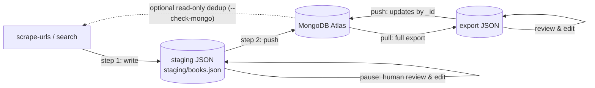
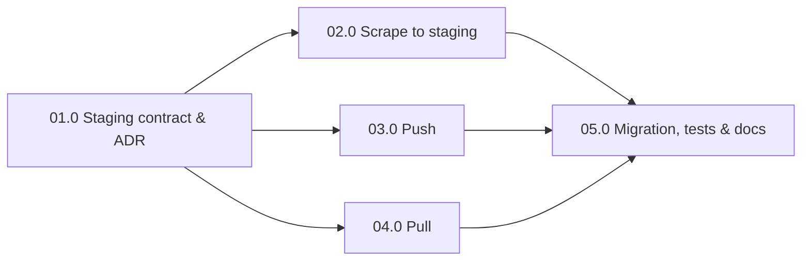

# Milestone 0002 - Staged Review & Two-Way Mongo Sync

**Package:** `bookscraper` | **Module root:** `src/bookscraper/` | **Tests:** `tests/{unit,mock,integration}/`

Replace the "Mongo **or** JSON" choice (`--store-backend {mongo|json}`) with a two-step, human-in-the-loop pipeline:
**scrape → JSON staging file → (pause: human review & edit) → push → MongoDB Atlas**. JSON stops being an
alternative store and becomes the review surface; MongoDB becomes the single system of record. The flow is
bidirectional: a new `pull` command exports the entire MongoDB collection to a JSON file in the same schema, which
can be reviewed, edited, and pushed back.

Progress lives in [status.md](/docs/roadmap/0002-staged-review-and-mongo-sync/status.md). Taxonomy and file
conventions: [docs/roadmap/README.md](/docs/roadmap/README.md).

## Target data flow

| Step      | Command                                                                                          | Reads                                                         | Writes                       |
|-----------|--------------------------------------------------------------------------------------------------|---------------------------------------------------------------|------------------------------|
| 1. Scrape | `bookscraper scrape-urls -f urls.json [--staging-file staging/books.json]`, `bookscraper search [...]`    | staging file (dedup); Mongo only with `--check-mongo`, read-only | staging file only         |
| 2. Review | a human, in an editor                                                                            | -                                                             | staging file                 |
| 3. Push | `bookscraper push [--staging-file staging/books.json] [--dry-run] [--allow-updates] [--approved-only]` | staging file, Mongo                                           | Mongo, `push_report.json`  |
| Reverse   | `bookscraper pull -o staging/books_mongo.json [--force]`                                                 | Mongo                                                         | the export file              |

## Design decisions (recorded in [ADR 0003](/docs/adr/0003-staged-review-and-two-way-sync.md))

- **No scraping command writes to MongoDB.** `--store-backend` is removed from `scrape-urls` and `search`; their only
  write target is the staging file (`--staging-file`, default `staging/books.json`).
- **Identity across the round trip is `_id`, not `hash`.** A pulled document carries Mongo's `_id` as a 24-hex
  string; a freshly scraped one has none. On push: no `_id` → insert (skipped as a duplicate if its `hash`
  already exists); `_id` → compare with the live document → *unchanged* (skip) or *update*. `hash` is recomputed
  from the edited fields at push time, so a reviewer's title fix cannot leave a stale hash behind.
- **Updates are opt-in.** If the plan contains any update and `--allow-updates` is absent, `push` refuses the
  whole run before writing anything (exit 1). Inserts alone never need a flag.
- **Review state lives in the file, not in Mongo.** An optional reserved `_staging` object per document
  (`{"status": "pending" | "approved" | "rejected", "scraped_at": ..., "source": ...}`) is stripped before any
  write. `rejected` documents are never pushed; `--approved-only` pushes only `approved` ones.
- **Validate the whole file first, then write.** Any invalid document (missing required field, malformed `_id`,
  a key starting with `$` or containing `.`, an `_id` that does not exist in Mongo) rejects the entire push -
  the same fail-loudly rule as `load_input_urls()`. Per-document *write* errors after validation are reported
  in `push_report.json` and make the exit code non-zero, but do not roll back other documents.
- **Push never modifies the staging file.** Re-running `push` is idempotent (inserted books become
  duplicates); to get `_id`s for newly inserted books, `pull`.
- **`pull` never clobbers.** It refuses to overwrite an existing file without `--force`, writes atomically
  (temp file + rename, the `cert_rotation.py` pattern), serializes `_id` to a string, and sorts by `_id` for
  stable diffs.
- **Step 1 works without Mongo.** Dedup reads the staging file; `--check-mongo` additionally consults Mongo
  **read-only** to avoid re-scraping books already in the database.

## Tasks

| Task | Name                                | Category | Priority | Depends on       | Output                                                                                                              |
|------|-------------------------------------|----------|----------|------------------|---------------------------------------------------------------------------------------------------------------------|
| 01.0 | Staging contract & ADR              | feature  | P0       | -                | ADR 0003; staging document contract (`_id`, `_staging`); validated, atomic staging-file I/O; hash recompute         |
| 02.0 | Scrape to staging (step 1)          | feature  | P0       | 01.0             | `scrape-urls` / `search` write only the staging file; `--store-backend` removed; optional read-only `--check-mongo` |
| 03.0 | Push to MongoDB (step 2)            | feature  | P0       | 01.0             | `bookscraper push`: pure planner, `--dry-run`, `--allow-updates`, `--approved-only`, bulk writer, report          |
| 04.0 | Pull MongoDB to JSON (reverse flow) | feature  | P1       | 01.0             | `bookscraper pull -o FILE [--force]`: full-collection, stable-ordered, atomic export; pull → push is a no-op      |
| 05.0 | Migration, tests & documentation    | chore    | P0       | 02.0, 03.0, 04.0 | Retired `--store-backend` tests, end-to-end two-step mock test, CLAUDE.md/README/docs, milestone 0001 reconciled    |

## Execution order

1. **01.0** first - every other task builds on the staging contract and its I/O module.
2. **03.0 and 04.0** in parallel after 01.0 (both touch only `backends/mongo/` plus new commands); 03.0's planner
   is pure logic and can land before its writer.
3. **02.0** after 01.0. It is the breaking CLI change, so land it together with (or right after) 03.0 - there must
   never be a release in which scraped books cannot reach Mongo at all.
4. **05.0** last: test migration, the round-trip test, and documentation.

## Relationship to milestone 0001

This milestone **supersedes** the "one interchangeable backend per run" design of 0001 task 01.0 (Storage backend
abstraction). Reconciled in 05.0 subtask 04:

- 0001 01.0/04 (`--store-backend` selection) - delivered; reverted for `scrape-urls` / `search`.
- 0001 01.0/05 (Mongo save hardening) and 01.0/06 (secondary lookup indexes) - still relevant; they move under the
  push writer (03.0/02) and the `--check-mongo` lookups (02.0/03) respectively.
- 0001 01.0/07 (JSON store atomic write & cache) - absorbed by 0002 01.0/03.
- 0001 01.0/08 (backend parity contract tests) - replaced by 0002 04.0/03 (pull → push round-trip fidelity).
- 0001 05.0/04 (`--dry-run`) and 05.0/05 (exit-code contract) - `push --dry-run` and the push exit codes must
  follow the contract 05.0 defines; whichever lands first sets it.

## Cross-cutting guidelines

Inherits every rule in [0001's cross-cutting guidelines](/docs/roadmap/0001-generic-implementation/plan.md#cross-cutting-guidelines)
(coding standard, one-way imports, fail loudly, secrets never leave the process, tests per tier, test docstrings,
per-subtask verification). Additionally:

- **The staging file is untrusted input.** It is hand-edited and its contents reach the system of record: validate
  shape, types, and key names before any network call. Subtasks that write to Mongo are marked
  **Role:** *Security Auditor → Python Expert*.
- **Explicit over implicit:** no command silently changes which file or database it touches; every write target is
  visible on the command line or is a documented default printed at the start of the run.
- **No test touches the real staging file, export file, or Mongo.** Extend `isolated_local_store` (or add an
  `isolated_staging_file` fixture) in `tests/conftest.py`.

## Definition of done (milestone)

- [x] Every task row in [status.md](/docs/roadmap/0002-staged-review-and-mongo-sync/status.md) is ✅ Complete.
- [x] `--store-backend` no longer exists anywhere in `src/`, `tests/`, CLAUDE.md, or README.md.
- [x] `scrape-urls` → hand edit → `push --dry-run` → `push` works end-to-end against a mocked collection (test).
- [ ] ... and, once, against Atlas (recorded in the PR) - pending `TEST_MONGODB_URI_PASS`; see status.md.
- [x] `pull` → `push --dry-run` on the untouched export reports 100% *unchanged* and zero writes.
- [x] Coverage stays ≥90% (`uv run pytest -m "not integration" --cov=bookscraper`).
- [x] CLAUDE.md's *Storage backend*, *Running*, *Testing*, and *Architecture* sections describe the shipped flow.

## Resolved questions

Decided by the project owner on 2026-11-19 and recorded in
[ADR 0003](/docs/adr/0003-staged-review-and-two-way-sync.md):

1. **Command names:** `push` / `pull` (over `submit` / `pull` and a `mongo` command group).
2. **Default staging path:** a dedicated, gitignored `staging/` directory - `staging/books.json` for scrape output,
   `staging/books_mongo.json` as the documented `pull` example - instead of reusing the repo-root `books.json`.
3. **Deletions:** **no** - `push` never deletes; deletion, if ever needed, gets its own explicit command.
4. **`_staging.status` default:** new documents start `pending` and are pushed unless marked `rejected`;
   `--approved-only` remains available as a stricter opt-in.
